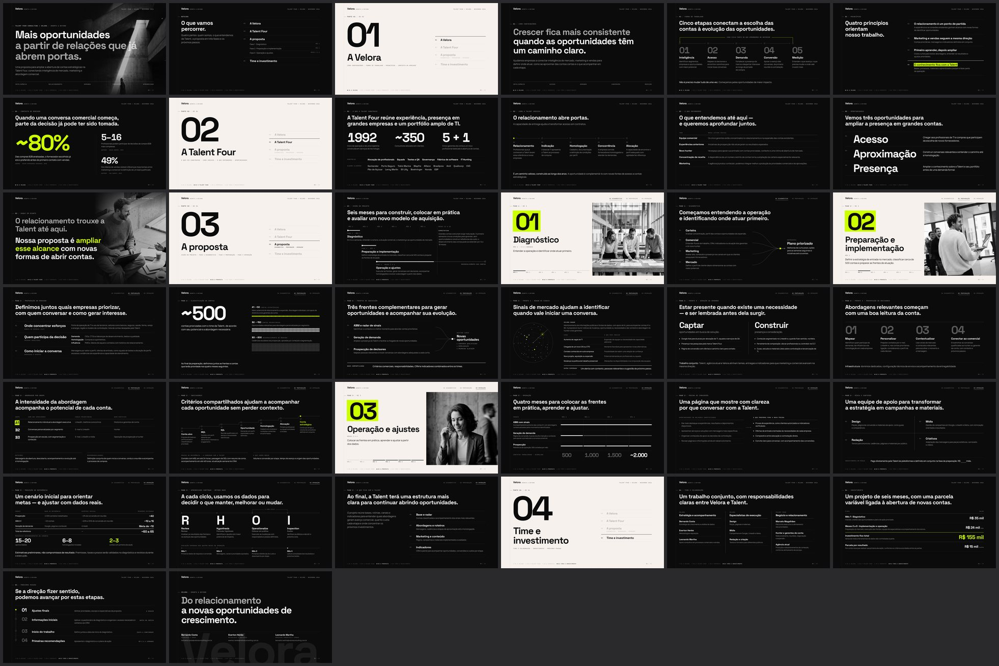

# Talent Four × Velora · Proposta

Apresentação da proposta da Velora para a Talent Four Consulting: 38 slides em HTML (1920×1080), com navegação por teclado e exportação em PDF. A copy segue o documento de correção editorial de novembro de 2026.



- **Apresentar:** abra `index.html` no Chrome, Edge ou Safari. A pasta inteira precisa ir junto, porque as fontes e as fotos são arquivos locais. Funciona sem internet.
- **PDF pronto:** [`talent-four-velora.pdf`](talent-four-velora.pdf) (38 páginas, 2,2 MB).

## Navegação

| Tecla | Ação |
|---|---|
| `→` `↓` `espaço` `PageDown` | Próximo slide |
| `←` `↑` `PageUp` | Slide anterior |
| `Home` / `End` | Primeiro / último |
| número + `Enter` | Vai direto ao slide (ex.: `16` `Enter`) |
| `G` | Visão geral; clique num slide para abri-lo |
| `F` | Tela cheia |

Também dá para clicar (metade direita avança, metade esquerda volta), deslizar no celular ou abrir direto num slide com `index.html#16`.

## Exportar

- **Pelo navegador:** Ctrl/Cmd + P → "Salvar como PDF". As margens já vêm zeradas e cada slide ocupa uma página.
- **Pelo script:** gera um PNG por slide e o PDF.

```sh
npm i -D playwright && npx playwright install chromium   # uma vez
node render.mjs            # → render/slide-NN.png e talent-four-velora.pdf
```

## Estrutura

| Slides | Parte | Conteúdo |
|---|---|---|
| 1–2 | Abertura | Capa e roteiro |
| 3–7 | **01 · A Velora** | Como contribuímos · cinco etapas · princípios · contexto de mercado |
| 8–13 | **02 · A Talent Four** | O que foi construído · como cresceu · o que entendemos · três oportunidades · transição |
| 14–33 | **03 · A proposta** | Visão do projeto e as três fases abaixo |
| 16–17 | Fase 1 · Diagnóstico | Quatro lentes e plano priorizado |
| 18–26 | Fase 2 · Preparação e implementação | Preparação do mercado · ~500 contas · frentes · radar de sinais · geração de demanda · prospecção · abordagem por grupo · indicadores |
| 27–33 | Fase 3 · Operação e ajustes | Operação mês a mês · página de conversão · mídia e conteúdo · projeção de referência · RHOI · o que fica com a Talent |
| 34–37 | **04 · Time e investimento** | Time · investimento · próximos passos |
| 38 | Encerramento | Contatos |

## Como as mudanças de fase ficam visíveis

- **Fundo:** todos os slides de conteúdo ficam em Ink. O Bone aparece só nas sete aberturas (quatro partes e três fases). Não há alternância de fundo slide a slide; a troca de fundo sinaliza que a apresentação mudou de parte ou de fase.
- **Aberturas de parte:** numeral gigante, nome da parte, o que vem nela e um índice das quatro partes com a atual destacada.
- **Aberturas de fase:** numeral em marca-texto ácido, foto P&B do site, duração e trilho dos seis meses com os meses da fase marcados.
- **Em todo slide:** o rodapé mostra as quatro partes com a atual destacada. Dentro da proposta, o topo mostra `01 Diagnóstico · 02 Preparação · 03 Operação` com a fase atual sublinhada, e o rótulo de cada slide começa com "Fase N".

## Linguagem visual (do site da Velora)

- **Tokens:** Ink `#0B0B0C`, Raise `#141416`, Acid `#CCFF00`, Bone `#F7F1ED` e Paper `#FFFFFF`. O texto secundário fica em 64%.
- **Fontes:** Space Grotesk 700, Manrope e JetBrains Mono, em `fonts/` (SIL Open Font License).
- **Estrutura:** uma linha vertical fina à esquerda, com os rótulos pendurados nela; nós quadrados; fios em vez de caixas; tabelas com cabeçalho em mono e números tabulares.
- **Ácido:** no máximo um ponto por slide. No fundo claro, só como marca-texto atrás de texto Ink.

## A validar antes de apresentar

Do documento de correção (seção 3):

- **Slide 7:** conferir fonte, universo e formulação exata das três estatísticas.
- **Slide 9:** validar com a Talent os dados de carteira e equipe, e a autorização para citar clientes.
- **Slide 26:** definir "reunião qualificada", "oportunidade", "homologação" e "conta estratégica". Os prazos aparecem como referência a combinar.
- **Slide 31:** o total foi padronizado em ~60 a 65 reuniões (40 + 10 a 15 + 10). Falta definir atribuição e deduplicação entre frentes.
- **Slides 23, 30 e 35:** confirmar a divisão de trabalho entre o squad da Velora, a agência atual e o time da Talent.
- **Slide 35:** confirmar o papel de Leonardo Wartha (advisor ou sócio).
- **Slide 36:** formalizar em contrato o que conta como conta nova e como primeira alocação para o bônus. Revisar a mensalidade agora que inclui o squad.
- **Slide 30:** verba de mídia, campo em branco.
- **Slide 37:** data de início.
- **Slides 20 e 25:** os tiers seguem A1/B2/B3. O documento sugere A/B/C como alternativa.

Escolhas de layout que não vêm do documento:

- Roteiro (slide 2), as sete aberturas e o encerramento com contatos.
- Rótulos e subtítulos das aberturas.
- Slide 21: o destino "Novas oportunidades" (conversa qualificada, homologação, primeira alocação) como desenho de apoio.
- Slide 28: o acumulado de contatos mês a mês (500 / 1.000 / 1.500 / ~2.000).
- Slide 37: as etiquetas de prazo "A seguir" e "Antes do início".
